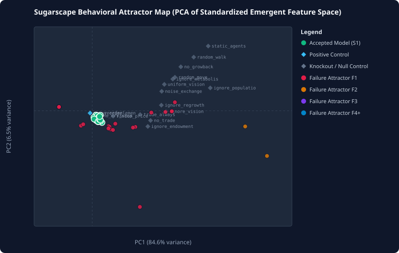

# Sugarscape Auto-Ablation: Behavioral Clustering & Attractor Report (`full`)

- **Updated**: `2026-11-20T14:31:42+00:00`
- **Active Trajectory**: `Trajectory #3` (`2` plateau resets completed)
- **Total Attempts Logged**: `117` (`83` with full behavioral vectors)

---

## 1. Multi-Trajectory Compression & Plateau Reset History

Each trajectory starts from the canonical flattened Mesa Sugarscape (`canonical_strategy.py`), compresses complexity $C$ until a statistically significant plateau is reached, and resets to explore an independent ablation path.

| Trajectory | Status | Generations | Attempts | Origin $C$ | Champion $C$ | Saved ($\Delta C$) | NCD vs. Canonical | Modified Mechanisms | Plateau Reason |
| :--- | :--- | :---: | :---: | :---: | :---: | :---: | :---: | :--- | :--- |
| **T1** | ✅ Plateaued & Reset | 10 | 21 | `6158` B | `6142` B (`6bcb34abcfe2fdf2`) | **-16 B** | `0.173` | mrs_stop:removed | diminishing_returns: relative C reduction over last 6 generations is 0.0000% (< 0.20% threshold) with 0 mechanism-level acceptances |
| **T2** | ✅ Plateaued & Reset | 15 | 61 | `6158` B | `1175` B (`5869928c303c094b`) | **-4983 B** | `0.858` | mesa_framework:replaced | frontier_stagnation: 6 generations (27 attempts) without C_min improvement (95% upper bound on per-attempt improvement rate p < 0.105) |
| **T3** | 🔄 Active | — | — | — | `1105` B (`5d5427fcf04ac08c`) | — | `0.867` | (in progress) | active trajectory |

### Cross-Trajectory Champion Convergence (Pairwise AST Normalized Compression Distance)

| Champion | T1 | T2 | T3 |
| :--- | :---: | :---: | :---: |
| **T1** | `0.000` | `0.860` | `0.865` |
| **T2** | `0.867` | `0.000` | `0.760` |
| **T3** | `0.866` | `0.763` | `0.000` |

---

## 2. Failure Attractors (Clustered Rejection Modes)

Rejected attempts are clustered in standardized behavioral response space and matched against the 17 pre-registered calibration controls/knockouts.

| Cluster | Archetype | Count | Trajectories Hit | Cross-Trajectory? | Failed Features | Top Failing Statistics | Nearest Control | Targeted Mechanisms |
| :---: | :--- | :---: | :---: | :---: | :---: | :--- | :--- | :--- |
| **`F1`** | E2+E3 Breakdown (~ko_no_mrs_stop) | `12` | T1, T2, T3 | 🔥 **YES** | `E2, E3, E1, E4, E5` | `pop_traj(l2), plateau_frac(l2), loghill_T(slope)` | `ko_no_mrs_stop` | move_tiebreak (5), mesa_framework (3), two_goods (2) |
| **`F2`** | E1+E2 Breakdown (~ko_ignore_regrowth) | `2` | T2 | No | `E1, E2, E3, E4, E5` | `plateau_frac(slope), pop_traj(l2), disp_late(slope)` | `ko_ignore_regrowth` | heterogeneity (1), none (1) |
| **`G0`** | Stage 0 Gate Rejection (Complexity / Guard / Smoke) | `47` | T1, T2, T3 | 🔥 **YES** | `Stage 0/1` | `—` | `stage_0_gate` | mesa_framework (14), two_goods (8), none (5) |
| **`G1`** | Stage 1 Gate Rejection (Complexity / Guard / Smoke) | `3` | T2, T3 | 🔥 **YES** | `Stage 0/1` | `—` | `stage_1_gate` | mesa_framework (2), none (1) |

---

## 3. Mechanism Necessity & Feature Sensitivity Matrix

Worst-case feature discrepancy ratio ($\text{ratio} < 1.0$ passes equivalence; $\ge 1.0$ fails) observed when each Sugarscape mechanism was targeted for ablation.

| Mechanism | Classification | Attempts (Acc / Rej) | Trajectories Modified | Max E1 | Max E2 | Max E3 | Max E4 | Max E5 | Primary Failure Attractor |
| :--- | :--- | :---: | :---: | :---: | :---: | :---: | :---: | :---: | :---: |
| **`growback`** | compressible | `2` (`1` / `1`) | — | `1.99` | `1.61` | `1.81` | `1.58` | `3.13` | `F1` |
| **`move_welfare`** | untested/under-explored | `0` (`0` / `0`) | — | `0.00` | `0.00` | `0.00` | `0.00` | `0.00` | `none` |
| **`move_tiebreak`** | compressible | `13` (`5` / `8`) | T3 | `1.27` | `2.22` | `1.43` | `1.01` | `1.55` | `F1` |
| **`welfare`** | untested/under-explored | `1` (`0` / `1`) | — | `0.00` | `0.00` | `0.00` | `0.00` | `0.00` | `G0` |
| **`metabolism`** | untested/under-explored | `1` (`0` / `1`) | — | `0.00` | `0.00` | `0.00` | `0.00` | `0.00` | `G0` |
| **`death`** | untested/under-explored | `0` (`0` / `0`) | — | `0.00` | `0.00` | `0.00` | `0.00` | `0.00` | `none` |
| **`vision`** | untested/under-explored | `0` (`0` / `0`) | — | `0.00` | `0.00` | `0.00` | `0.00` | `0.00` | `none` |
| **`trade`** | compressible | `6` (`1` / `5`) | — | `0.64` | `0.71` | `0.62` | `0.65` | `0.66` | `G0` |
| **`mrs_stop`** | compressible | `5` (`3` / `2`) | T1 | `0.79` | `0.55` | `0.81` | `0.56` | `0.78` | `G0` |
| **`price_rule`** | compressible | `3` (`1` / `2`) | — | `0.70` | `0.62` | `0.49` | `0.63` | `0.62` | `G0` |
| **`heterogeneity`** | load-bearing (candidate) | `4` (`0` / `4`) | — | `2.98` | `9.85` | `4.36` | `4.94` | `14.59` | `G0` |
| **`two_goods`** | compressible | `11` (`1` / `10`) | — | `1.06` | `1.77` | `1.36` | `1.22` | `1.64` | `G0` |
| **`random_activation`** | compressible | `5` (`1` / `4`) | — | `0.65` | `0.53` | `0.87` | `0.56` | `0.99` | `G0` |
| **`mesa_framework`** | compressible | `21` (`2` / `19`) | T2, T3 | `1.73` | `1.75` | `1.85` | `1.34` | `4.53` | `G0` |
