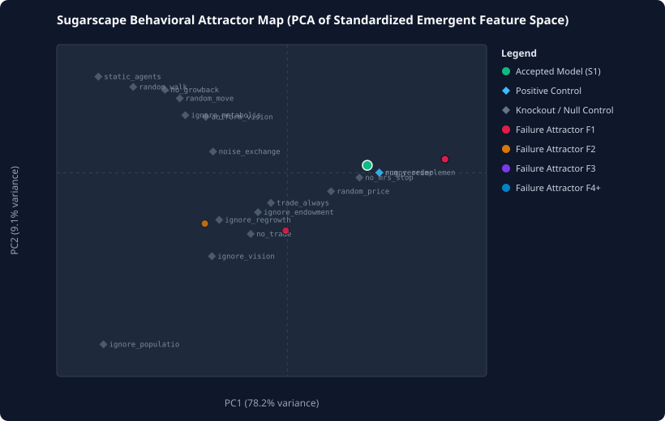

# Sugarscape Auto-Ablation: Behavioral Clustering & Attractor Report (`full`)

- **Updated**: `2026-11-08T20:08:42+00:00`
- **Active Trajectory**: `Trajectory #1` (`0` plateau resets completed)
- **Total Attempts Logged**: `0` (`0` with full behavioral vectors)

---

## 1. Multi-Trajectory Compression & Plateau Reset History

Each trajectory starts from the canonical flattened Mesa Sugarscape (`canonical_strategy.py`), compresses complexity $C$ until a statistically significant plateau is reached, and resets to explore an independent ablation path.

---

## 2. Failure Attractors (Clustered Rejection Modes)

Rejected attempts are clustered in standardized behavioral response space and matched against the 17 pre-registered calibration controls/knockouts.

*(No rejected attempts logged yet.)*

---

## 3. Mechanism Necessity & Feature Sensitivity Matrix

Worst-case feature discrepancy ratio ($\text{ratio} < 1.0$ passes equivalence; $\ge 1.0$ fails) observed when each Sugarscape mechanism was targeted for ablation.

| Mechanism | Classification | Attempts (Acc / Rej) | Trajectories Modified | Max E1 | Max E2 | Max E3 | Max E4 | Max E5 | Primary Failure Attractor |
| :--- | :--- | :---: | :---: | :---: | :---: | :---: | :---: | :---: | :---: |
| **`growback`** | untested/under-explored | `0` (`0` / `0`) | — | `0.00` | `0.00` | `0.00` | `0.00` | `0.00` | `none` |
| **`move_welfare`** | untested/under-explored | `0` (`0` / `0`) | — | `0.00` | `0.00` | `0.00` | `0.00` | `0.00` | `none` |
| **`move_tiebreak`** | untested/under-explored | `0` (`0` / `0`) | — | `0.00` | `0.00` | `0.00` | `0.00` | `0.00` | `none` |
| **`welfare`** | untested/under-explored | `0` (`0` / `0`) | — | `0.00` | `0.00` | `0.00` | `0.00` | `0.00` | `none` |
| **`metabolism`** | untested/under-explored | `0` (`0` / `0`) | — | `0.00` | `0.00` | `0.00` | `0.00` | `0.00` | `none` |
| **`death`** | untested/under-explored | `0` (`0` / `0`) | — | `0.00` | `0.00` | `0.00` | `0.00` | `0.00` | `none` |
| **`vision`** | untested/under-explored | `0` (`0` / `0`) | — | `0.00` | `0.00` | `0.00` | `0.00` | `0.00` | `none` |
| **`trade`** | untested/under-explored | `0` (`0` / `0`) | — | `0.00` | `0.00` | `0.00` | `0.00` | `0.00` | `none` |
| **`mrs_stop`** | untested/under-explored | `0` (`0` / `0`) | — | `0.00` | `0.00` | `0.00` | `0.00` | `0.00` | `none` |
| **`price_rule`** | untested/under-explored | `0` (`0` / `0`) | — | `0.00` | `0.00` | `0.00` | `0.00` | `0.00` | `none` |
| **`heterogeneity`** | untested/under-explored | `0` (`0` / `0`) | — | `0.00` | `0.00` | `0.00` | `0.00` | `0.00` | `none` |
| **`two_goods`** | untested/under-explored | `0` (`0` / `0`) | — | `0.00` | `0.00` | `0.00` | `0.00` | `0.00` | `none` |
| **`random_activation`** | untested/under-explored | `0` (`0` / `0`) | — | `0.00` | `0.00` | `0.00` | `0.00` | `0.00` | `none` |
| **`mesa_framework`** | untested/under-explored | `0` (`0` / `0`) | — | `0.00` | `0.00` | `0.00` | `0.00` | `0.00` | `none` |
